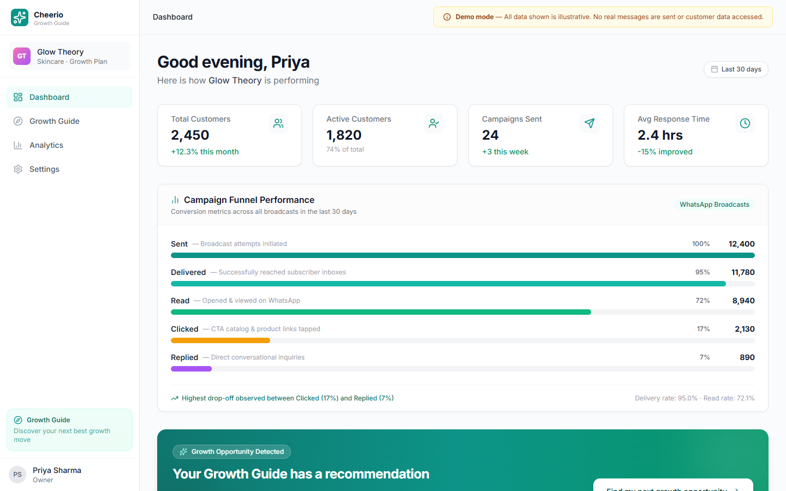
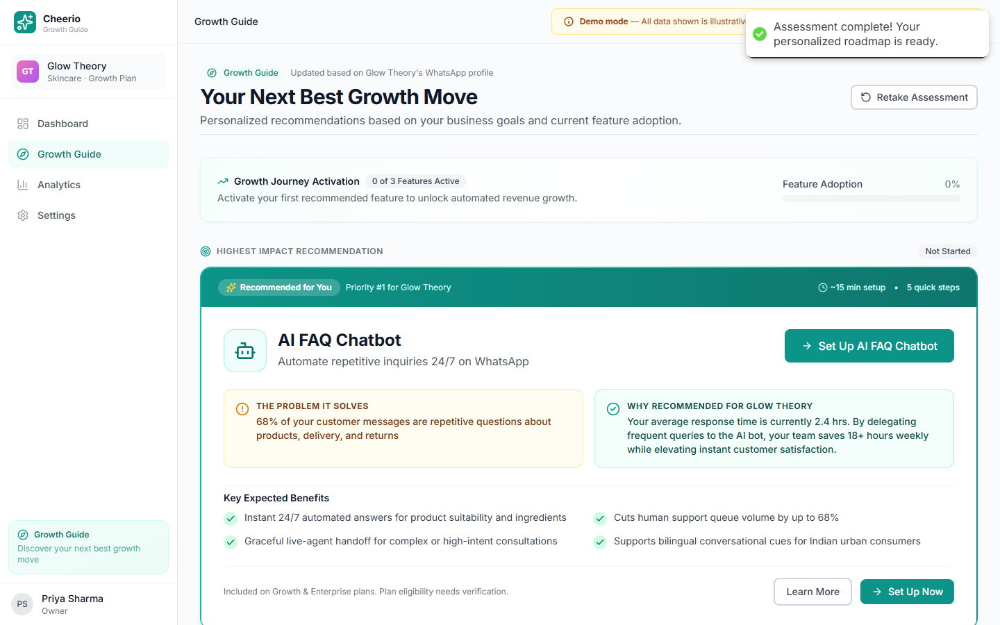
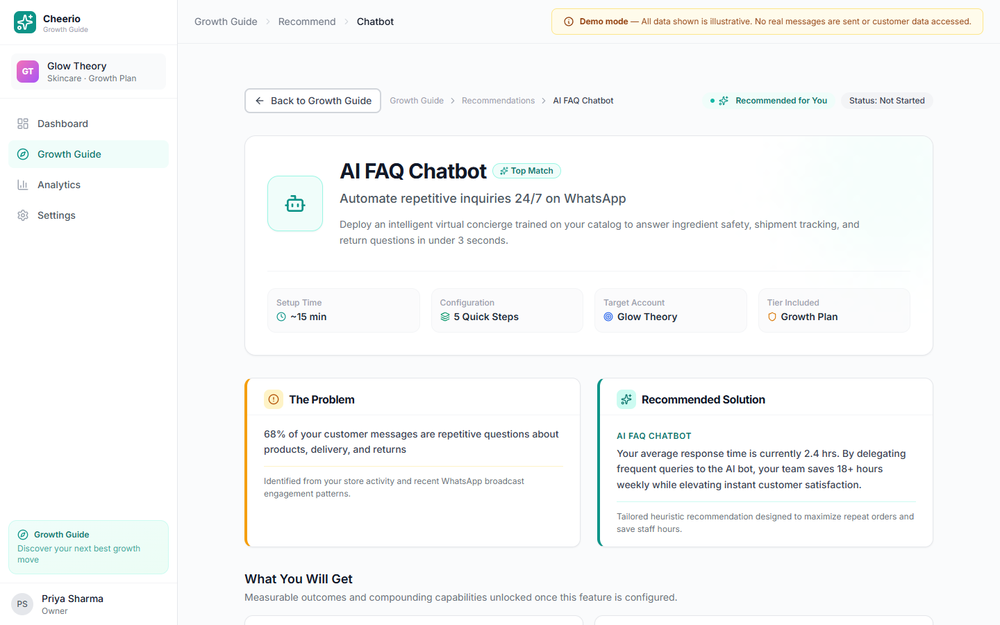
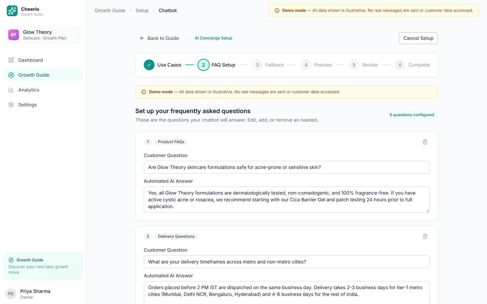
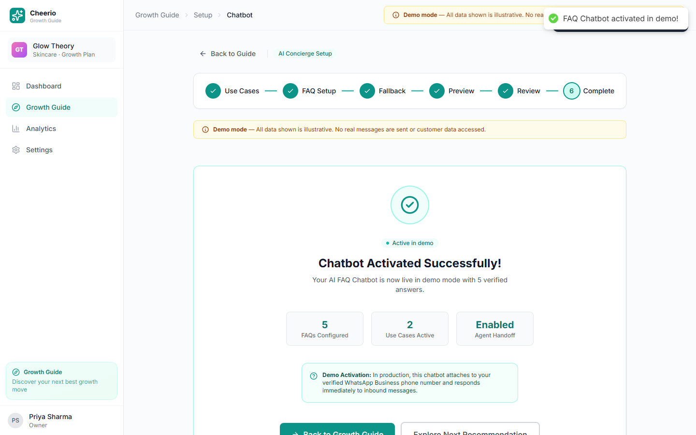

# Cheerio Growth Guide

> **"Your next best growth move."**

An interactive, high-fidelity product prototype and comprehensive PM deliverable suite for the **Cheerio AI Product Intern Assignment (Assignment B: "Users don't know what they can do on Cheerio")**.

Cheerio Growth Guide transforms generic feature catalogues into goal-driven, contextual recommendations paired with interactive setup wizards, testing sandboxes, and adoption analytics.

[](https://nextjs.org/)
[](https://www.typescriptlang.org/)
[](https://tailwindcss.com/)
[](LICENSE)
[](tests/test-runner.ts)
[](https://growth-guide-saas.vercel.app/)

> 🌐 **Live Interactive Prototype:** [https://growth-guide-saas.vercel.app/](https://growth-guide-saas.vercel.app/)

---

## 📌 Problem Statement

Cheerio empowers businesses with unified customer communication tools—including WhatsApp campaigns, AI chatbots, email, SMS, Instagram, RCS, AI voice, automations, and CRM segmentation.

However, many business owners sign up, broadcast a few initial promotional campaigns, fail to discover higher-value capabilities (e.g., automated response flows, customer segmentation, 24/7 AI chatbots), and eventually disengage or churn due to under-realized platform ROI.

---

## 💡 Product Concept & The User

**Cheerio Growth Guide** acts as an always-on, intelligent growth co-pilot embedded directly into the Cheerio dashboard. Instead of expecting busy business owners to browse through documentation or navigate complex feature trees, Growth Guide diagnoses their immediate operational bottleneck and recommends the single highest-impact "next best move."

### Target User Persona
- **Persona:** Priya Sharma (Founder & Operator at *Glow Theory*, a fast-growing D2C skincare brand).
- **Current Behavior:** Regularly sends weekly promotional WhatsApp broadcasts to a subscriber list of 2,450 customers.
- **Pain Points:** 
  - Spends 3+ hours daily manually answering repetitive customer queries about ingredients, order dispatch, and returns.
  - Suffers from low campaign click-to-purchase conversions because all customers receive identical promotional blasts.
  - Lacks technical engineering support to build custom APIs or complex webhooks.
- **Goal:** Automate repetitive support and increase repeat orders without hiring additional staff.

---

## 📸 Product Screenshots

| 1. Unified Dashboard & Recommendation Banner | 2. 3-Question Diagnostic Assessment |
| :---: | :---: |
|  |  |
| *Contextual growth banner dynamically highlights the next opportunity based on current account usage.* | *Quick diagnostic captures business goals, operational bottlenecks, and existing setup in < 60 seconds.* |

| 3. Personalized Recommendation Detail | 4. Interactive Setup & Testing Sandbox |
| :---: | :---: |
|  |  |
| *Transparent ROI breakdown: explains why the feature was picked, time-to-value, and prerequisites.* | *6-step guided wizard with an embedded WhatsApp chat simulator to test FAQs before live activation.* |

| 5. Adoption Analytics & North Star Tracking |
| :---: |
|  |
| *Live adoption metrics tracking impressions, engagements, activations, and 30-day meaningful use events.* |

---

## 🗺️ The End-to-End User Journey

```
┌─────────────────┐     ┌───────────────────────┐     ┌────────────────────────┐
│ 1. Dashboard    │ ──> │ 2. Growth Assessment  │ ──> │ 3. Contextual Rec      │
│ Metrics & Banner│     │ Goals, Bottlenecks    │     │ Problem & ROI Teardown │
└─────────────────┘     └───────────────────────┘     └────────────────────────┘
                                                                   │
                                                                   ▼
┌─────────────────┐     ┌───────────────────────┐     ┌────────────────────────┐
│ 6. Analytics    │ <── │ 5. Demo Activation    │ <── │ 4. Guided Setup Wizard │
│ North Star & Log│     │ State Persistence     │     │ Interactive Sandbox    │
└─────────────────┘     └───────────────────────┘     └────────────────────────┘
```

1. **Dashboard Discovery:** The merchant visits their dashboard and sees an ambient notification: *"Your Growth Guide has a recommendation."*
2. **Diagnostic Assessment:** A 3-question guided diagnostic evaluates current business objectives (*"Answer customer questions faster"*), primary operational friction (*"Repeating answers to common queries"*), and existing tool usage (*"WhatsApp Campaigns"*).
3. **Contextual Recommendation:** The engine maps these inputs to the **AI FAQ Chatbot**, clearly detailing the time commitment (~15 mins) and anticipated operational relief.
4. **Interactive Setup Wizard:**
   - **Step 0:** Select relevant use cases (Product FAQs, Delivery, Returns, Order Status).
   - **Step 1:** Configure and customize FAQ question/answer pairs.
   - **Step 2:** Configure polite fallback messaging and human agent handoff simulation.
   - **Step 3:** Test real queries in an interactive, simulated WhatsApp chat playground with real-time response matching.
   - **Step 4:** Review configuration summary and verify readiness.
   - **Step 5:** Complete activation.
5. **Simulated Activation:** Updates account state, awards an activation milestone, and writes an event log to the timeline.
6. **Analytics & Progress:** Displays adoption funnel velocity and tracks progress against the North Star metric.

---

## 🎯 North Star & Supporting Metrics

### North Star Metric
> **"Percentage of monthly active businesses that activate and meaningfully use at least one previously unused Cheerio feature within 30 days."**

- **Target Hypothesis:** +10 percentage points improvement over a 3-month rollout.
- **Baseline Protocol:** 2-week pre-launch observation period across a cohort of 5,000 active businesses.

### Supporting Metrics
1. **Recommendation-to-Activation Rate:** Measures the conversion efficiency from viewing a recommendation to completing wizard activation (Target: 25%).
2. **7-Day Meaningful Use Rate:** Measures whether newly activated features handle real activity (e.g., $\ge$ 5 bot conversations, $\ge$ 1 automated trigger) within 7 days of setup (Target: 60%).
3. **90-Day Cohort Retention:** Compares 90-day account survival rates between single-feature campaign senders vs. multi-feature activated merchants.

---

## 📊 Business Case & Financial Model Summary

The project is backed by a formula-driven, 8-sheet financial model ([`submission/cheerio_growth_guide_financial_model.xlsx`](submission/cheerio_growth_guide_financial_model.xlsx)) audited with zero circularities or cell formula errors.

### Executive Financial Reconciliation (Base Case)

| Metric Dimension | Reconciled Value | Source / Methodology |
| :--- | :--- | :--- |
| **Active Businesses Base** | **5,000 accounts** | Baseline active accounts growing at 2.0% MoM |
| **Full-Year Account-Months** | **67,058 account-months** | Compounding monthly active accounts across Months 1–12 |
| **Annual Cumulative Activations** | **4,695 businesses** | Funnel: 70% Reach $\times$ 40% Engagement $\times$ 25% Activation |
| **Year-1 In-Period Recognized Revenue** | **₹14,75,508** (~₹14.76 Lakh) | 492 customer-months recognized across Months 1–12 @ ₹2,999/mo ARPU |
| **Year-1 Total Realized Program Cost** | **₹13,07,627** (~₹13.08 Lakh) | AI Tokens (₹1,757) + Cloud Hosting (₹10,05,870) + Fixed Infra (₹3,00,000) |
| **Year-1 In-Period Net Realized Benefit** | **+₹1,67,881** (~₹1.68 Lakh) | In-Period Recognized Revenue minus Realized Cost (**11.4% margin**) |
| **Month-12 Retained Accounts** | **73 active accounts** | Cumulative surviving cohort at 2.0% incremental yield, 5% decay |
| **Month-12 Exit Monthly Run Rate (MRR)** | **₹2,18,927 / month** | 73 retained accounts $\times$ ₹2,999 monthly ARPU |
| **Month-12 Exit Annualized Run Rate (ARR)** | **₹26,27,124 / year** (~₹26.27 Lakh) | Exit MRR $\times$ 12 months |
| **Month-12 Recurring Operating Cost** | **₹1,18,417.79 / mo** (~₹1,18,418) | Fixed (₹25k) + M12 Hosting (6,217 accts $\times$ ₹15 = ₹93,255) + M12 AI (₹163) |
| **Annualized Month-12 Operating Cost** | **₹14,21,013.43 / yr** (~₹14.21 Lakh) | Month-12 Operating Cost $\times$ 12 months |
| **Exit Net Annualized Benefit (Run Rate)** | **₹12,06,110.57 / yr** (~₹12.06 Lakh) | Exit ARR minus Annualized Month-12 Operating Cost |
| **Exit Annualized Contribution Margin** | **45.9%** | Exit Net Benefit $\div$ Exit ARR (matches Month-12 margin: 45.9%) |

### Commercial & Infrastructure Attribution Notes
- **AI Token Economics:** Sized with official OpenAI GPT-4o-mini pricing (\$0.150/1M input, \$0.600/1M output tokens @ ₹84.00/USD reference FX). Across 4,695 activations averaging 18 setup/test interactions (84,510 total calls), the entire annual AI token expenditure is just **₹1,756.96**.
- **Conservative Hosting Burden:** The Base Case burdens Growth Guide with the **entire platform hosting cost** (67,058 account-months $\times$ ₹15 = ₹10,05,870) and ₹3.00 Lakh fixed overhead.
- **75% SaaS Margin Audit Check:** In the model audit sheet, the 75% hurdle triggers an honest status: `FLAG: BELOW 75% TARGET (45.9%)`. This is commercially justified because Year 1 absorbs all 5,000+ accounts before retained cohort compounding matures. Under incremental feature cost attribution (~₹4.75 Lakh), the margin exceeds **80%**. Under the Optimistic scenario, the margin reaches **77.9%**.
- **Retention Definition:** Refers strictly to the **incremental retained-account yield from newly activated businesses** (2.0% cohort contribution surviving under 5% baseline monthly decay), not an observed drop in total company-wide churn.

---

## 📁 Repository Structure

```
growth-guide-saas/
├── docs/                                # Technical & Product Documentation
│   ├── architecture.md                  # System architecture, state management & tech stack
│   ├── assumptions.md                   # Modeling assumptions, funnel sizing & benchmarks
│   ├── product-spec.md                  # PRD, user persona, user stories & failure modes
│   └── ai-usage-log-template.md         # Initial prompt framing & iteration notes
├── public/                              # Static public assets
├── screenshots/                         # Screenshots documentation
│   └── README.md
├── scripts/                             # Financial modeling & verification scripts
│   ├── audit-financial-model.js         # Cell-level automated audit for XLSX workbook
│   ├── calculate-scenarios.js           # Scenario modeling matrix calculator
│   ├── check-docx-pages.ps1             # Word COM script verifying strict 4-page ceiling
│   ├── generate-assignment-docx.js      # Generator for 4-page DOCX submission
│   └── generate-financial-model.js      # 8-sheet ExcelJS model generation script
├── src/
│   ├── app/                             # Next.js App Router (9 polished screens)
│   │   ├── page.tsx                     # Screen 1: Welcome & Persona Overview
│   │   ├── dashboard/page.tsx           # Screen 2: Unified Merchant Dashboard
│   │   ├── growth-guide/
│   │   │   ├── page.tsx                 # Screen 3: Diagnostic Assessment & Catalog
│   │   │   ├── recommend/[featureId]/   # Screen 4: Deep-Dive Recommendation Detail
│   │   │   └── setup/
│   │   │       ├── chatbot/page.tsx     # Screen 5: 6-Step FAQ Chatbot Wizard
│   │   │       ├── automation/page.tsx  # Screen 6: Follow-Up Automation Setup
│   │   │       └── crm/page.tsx         # Screen 7: Smart CRM Segmentation Explorer
│   │   ├── analytics/page.tsx           # Screen 8: Growth Analytics & Activity Log
│   │   └── settings/page.tsx            # Screen 9: Demo Controls & State Reset
│   ├── components/
│   │   ├── layout/AppLayout.tsx         # Responsive application shell & navigation
│   │   └── ui/index.tsx                 # Accessible, reusable design system components
│   ├── data/mock-data.ts                # Deterministic seed data & customer profiles
│   ├── lib/
│   │   ├── store.ts                     # React Context + localStorage persistence
│   │   └── utils.ts                     # String formatting & pure helper utilities
│   └── types/index.ts                   # Strongly typed domain & state definitions
├── submission/                          # Official Take-Home Assignment Deliverables
│   ├── screenshots/                     # 5 genuine, high-resolution prototype PNGs
│   ├── cheerio_growth_guide_assignment.docx # Reconciled 4-page Word document (verified)
│   ├── cheerio_growth_guide_assignment.md   # Exact 1:1 Markdown equivalent
│   ├── cheerio_growth_guide_financial_model.xlsx # Complete 8-sheet financial model
│   ├── AI-usage-log-template.md         # Genuine AI prompt transcripts & contributions
│   ├── FINAL-VERIFICATION-REPORT.md     # 12-section master audit & cell trace report
│   └── README-submission.md             # Detailed evaluator walkthrough & guidance
├── tests/
│   └── test-runner.ts                   # 26 automated unit & integration tests
├── LICENSE                              # MIT License
├── package.json                         # Dependencies & project scripts
└── README.md                            # Public repository overview
```

---

## 🛠️ Technology Stack

| Layer | Technology | Purpose |
| :--- | :--- | :--- |
| **Framework** | Next.js 14.2 (App Router) | React Server & Client Components, hybrid static/client rendering |
| **Language** | TypeScript 5.0 | Complete type safety across business logic, store, and UI |
| **Styling** | Tailwind CSS 3.4 | Consistent design system, modern gradients, responsive layouts |
| **Icons** | Lucide React | Semantic, accessible SVG iconography |
| **Charts** | Recharts 2.12 | Responsive trend visualization for adoption analytics |
| **Feedback** | react-hot-toast | Non-intrusive toast alerts for wizard and demo interactions |
| **Spreadsheet Engine** | ExcelJS | Generation and cell-level formula verification of 8-sheet model |
| **Document Engine** | docx | Generation of formatted executive Word document deliverables |
| **State & Storage** | React Context + localStorage | Hydration-safe demo state persistence without external DB setup |

---

## ⚡ Local Setup & Installation

### Prerequisites
- Node.js 18.x or higher
- npm 9.x or higher

### 1. Clone the Repository
```bash
git clone https://github.com/SamarthKapdi/growth-guide-saas.git
cd growth-guide-saas
```

### 2. Install Dependencies
```bash
npm install
```

### 3. Start Development Server
```bash
npm run dev
```
Open [http://localhost:3000](http://localhost:3000) in your browser.

---

## 🧪 Testing & Verification Suite

All core business logic, recommendation mapping, FAQ matching, and financial formulas are verified through automated test suites and audit scripts:

### Run Automated Unit & Integration Tests (26/26 Passing)
```bash
npm test
```
*Validates:*
- Recommendation engine mapping (Goals $\to$ Chatbot, Follow-up, CRM).
- FAQ multi-token overlap matching & fallback routing.
- CRM cohort segment assignment and engagement score boundaries.
- Number formatting and percentage edge cases.

### Build Production Application
```bash
npm run build
```
*Compiles all 12 static/dynamic Next.js routes with zero TypeScript or ESLint errors.*

### Audit Financial Model (Cell-by-Cell Trace)
```bash
node scripts/audit-financial-model.js
```
*Verifies formulas across all 8 sheets, confirms 0 cell formula errors, traces in-period revenue vs exit ARR, and validates audit hurdle flags.*

### Verify Word Document Page Count (Windows / Word COM)
```powershell
powershell -ExecutionPolicy Bypass -File scripts/check-docx-pages.ps1
```
*Confirms strict adherence to the 4-page assignment ceiling (`ACTUAL_WORD_PAGE_COUNT: 4`).*

---

## 📦 Submission Deliverables Index

All core internship deliverables are organized in the [`submission/`](submission/) directory:

1. **Four-Page Assignment Document:**
   - [`submission/cheerio_growth_guide_assignment.docx`](submission/cheerio_growth_guide_assignment.docx) — Formal submission document formatted to strictly 4 pages.
   - [`submission/cheerio_growth_guide_assignment.md`](submission/cheerio_growth_guide_assignment.md) — Exact 1:1 Markdown equivalent for browser viewing.
2. **Formula-Driven Financial Model:**
   - [`submission/cheerio_growth_guide_financial_model.xlsx`](submission/cheerio_growth_guide_financial_model.xlsx) — Dynamic 8-sheet Excel workbook with fully integrated assumptions, adoption funnels, GPT-4o-mini cost model, exit run-rate reconciliation, scenario analysis, and audit thresholds.
3. **Comprehensive Verification & Audit Report:**
   - [`submission/FINAL-VERIFICATION-REPORT.md`](submission/FINAL-VERIFICATION-REPORT.md) — 12-section technical audit documenting every formula trace, cell coordinate, and metric definition.
4. **Evaluator Guide & Walkthrough:**
   - [`submission/README-submission.md`](submission/README-submission.md) — Step-by-step evaluator instructions, feature teardowns, and architecture review.
5. **AI Usage & Contribution Log:**
   - [`submission/AI-usage-log-template.md`](submission/AI-usage-log-template.md) — Transparent record of prompts used, syntax/build issues resolved, and human product leadership reflections.
6. **Prototype Screenshots:**
   - [`submission/screenshots/`](submission/screenshots/) — 5 genuine high-resolution PNG captures.

---

## ⚠️ Important Disclaimers & Limitations

- **Simulated Environment:** This prototype is designed specifically to demonstrate product UX, recommendation logic, and setup ergonomics for evaluation purposes. It does not connect to live Meta WhatsApp Business APIs, live SMS gateways, or real production billing databases.
- **Deterministic Recommendation Engine:** Recommendations in this prototype are generated deterministically from diagnostic answers to maintain transparency, reliability, and reproducible testing without external API key dependencies.
- **Mock Customer Data:** All customer names (*Glow Theory*), phone numbers, email addresses, and message logs are entirely fictitious.
- **Illustrative Forecasts:** The 12-month financial model represents a structured product proposal based on conservative SaaS benchmarks and stated assumptions; it does not constitute historically realized company financial statements.

---

## 🚀 Deployment

- **Live Interactive Demo:** [https://growth-guide-saas.vercel.app/](https://growth-guide-saas.vercel.app/)
- **Hosting Platform:** [Vercel](https://vercel.com/) (Next.js App Router Edge / Serverless)
- **Deployment Status:** **Active & Live**
- The application is fully self-contained and zero-config ready. Any push to `main` triggers automatic continuous deployment and production releases on Vercel.

---

## 📄 License

This project is open-source software licensed under the [MIT License](LICENSE).  
Copyright (c) 2026 Samarth Kapdi.
